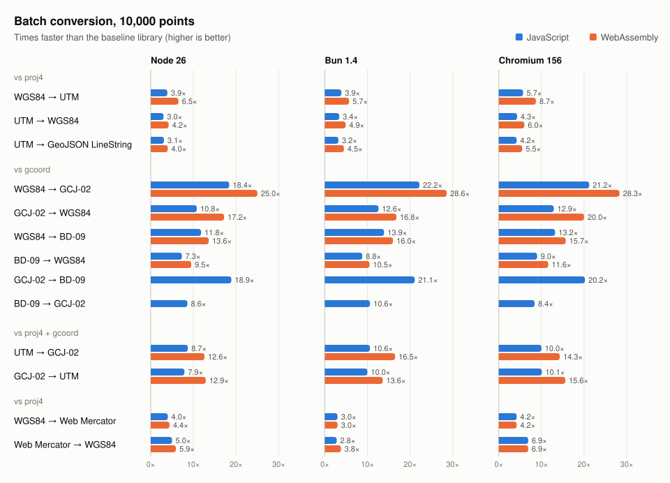
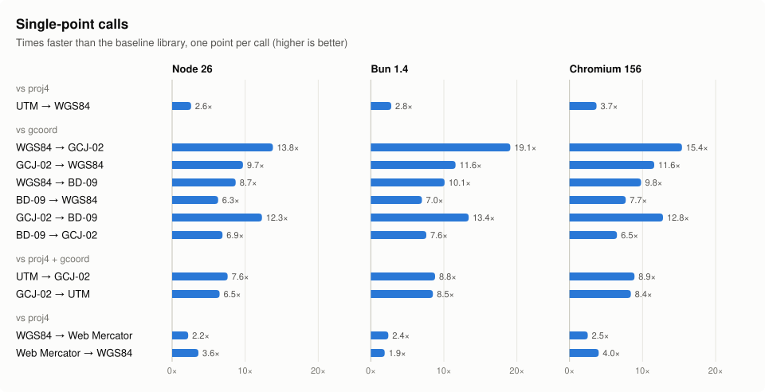

# fast-proj

[](https://www.npmjs.com/package/fast-proj)
[](https://github.com/cdcxd/fast-proj/actions/workflows/ci.yml)
[](LICENSE)

Fast coordinate conversions for JavaScript and TypeScript. Optimized arithmetic and typed-array batching support
reusable output buffers and in-place conversion, with no per-point allocations in the batch APIs, and an optional
Rust/WebAssembly SIMD backend for large batches.

```sh
npm install fast-proj
```

| package                           | contents                                                                                | docs                                                                                            |
| --------------------------------- | --------------------------------------------------------------------------------------- | ----------------------------------------------------------------------------------------------- |
| [`fast-proj`](packages/fast-proj) | UTM, transverse Mercator and Web Mercator ↔ WGS84, GCJ-02, BD-09, GeoJSON helpers, wasm | [API](docs/api.md) · [from proj4](docs/proj4.md) · [changelog](packages/fast-proj/CHANGELOG.md) |

## Performance

Times faster than proj4 2.23 (UTM, Web Mercator) and gcoord 1.0.7 (GCJ-02, BD-09), median of 31 samples, mean of three
runs:

<picture>
  <source media="(prefers-color-scheme: dark)" srcset="docs/img/bench-batch-dark.svg">
  
</picture>

<picture>
  <source media="(prefers-color-scheme: dark)" srcset="docs/img/bench-point-dark.svg">
  
</picture>

Timings vary with hardware, runtime and dataset. Tables with timings, baselines and reproduction commands:
[docs/benchmarks.md](docs/benchmarks.md).

## Development

Uses [Bun](https://bun.sh) workspaces (package manager), vitest, oxlint, oxfmt, TypeScript 7 and Rust 1.99 (for the
wasm build; `rustup target add wasm32-unknown-unknown`). A devcontainer is included.

```sh
bun install
bun run check    # format, lint, typecheck, build (TS + wasm), test
cd packages/fast-proj && bun run bench    # Node, Bun and Chromium
bun changeset    # describe a user-facing change for the CHANGELOG
```

Releases: see [`.changeset/README.md`](.changeset/README.md).

## License

MIT
