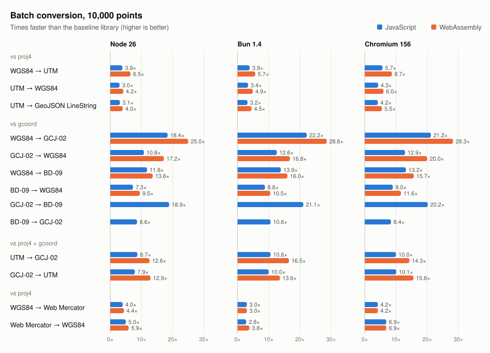
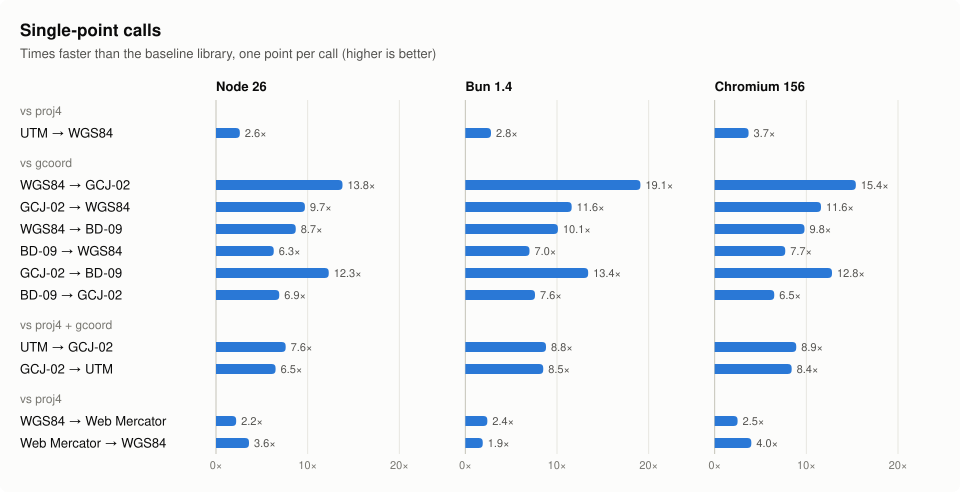

# fast-proj

Fast batch coordinate conversions for JavaScript and TypeScript: UTM, transverse Mercator and Web Mercator ↔ WGS84,
and WGS84 ↔ GCJ-02 ↔ BD-09 for maps of China, with typed-array APIs and an optional WebAssembly backend.

- Krüger series to 6th order (Karney 2011). Accuracy: ≤5e-9 m (6e-9 m near ±180°) / 1e-13° vs an exact reference;
  ≈6e-9 m / 1.3e-13° vs proj4.
- GCJ-02: the published formula, 11–22× faster than gcoord (17–29× with WebAssembly); the inverse is accurate to 3e-12°
  (gcoord: 1e-6°).
- BD-09 (Baidu), from WGS84 or directly from GCJ-02: 7–14× faster than gcoord through WGS84 (10–16× with
  WebAssembly); both directions within 1.5e-14° of the formula (gcoord's inverse: 2e-6°).
- Web Mercator (EPSG:3857): within five ulps of the correctly rounded exact value up to the poles; no clamping at ±85.05°.
- Leaflet 1.x and 2.0 layer for million-point tracks (`fast-proj/leaflet`): 20-45× faster zooms than `L.Polyline`, and an
  optional WGS84 → GCJ-02 shift for AMap and Tencent basemaps.
- No per-point allocations in the batch APIs; optional output buffers, in-place conversion.
- No dependencies, ESM-only, tree-shakeable. Node ≥ 20 and modern browsers.

```sh
npm install fast-proj
```

```ts
import { BD09, GCJ02, tmerc, utm, utmFor, webMercator } from 'fast-proj';
import { lineString } from 'fast-proj/geojson';

const zone33 = utm({ zone: 33 }); // or utm(utmFor(lon, lat))
const { lon, lat } = zone33.toLonLat(xs, ys); // Float64Array out
zone33.toLonLatInterleaved(xy, xy); // [x0, y0, x1, y1, ...] -> [lon0, lat0, ...], in place
const [x, y] = zone33.fromLonLatPoint(15, 52);
map.getSource('track').setData(lineString(xy)); // MapLibre

const gk = tmerc({ centralMeridian: 117, falseEasting: 500000 }); // Gauss-Krüger, CM 117E
utm({ zone: 50, geographic: GCJ02 }).toLonLatInterleaved(xy, xy); // UTM -> GCJ-02 for AMap/Tencent basemaps
GCJ02.fromWgs84Interleaved(lonlat, lonlat); // WGS84 -> GCJ-02, in place
BD09.fromGcj02Interleaved(lonlat, lonlat); // GCJ-02 -> BD-09 for Baidu (or BD09.fromWgs84Interleaved)
webMercator().fromLonLatInterleaved(lonlat, lonlat); // lon/lat -> EPSG:3857 x/y (on GCJ-02 lon/lat: AMap tiles)

import { FastPolyline } from 'fast-proj/leaflet';
new FastPolyline(lonlat, { color: '#e34948', weight: 2 }).addTo(leafletMap); // 1M points: redraws in 7-15 ms

import { loadWasm } from 'fast-proj/wasm'; // opt-in, ~72 kB
const wasm = await loadWasm();
wasm.utm({ zone: 33 }).toLonLatInterleaved(xy, xy);
```

Transverse Mercator's valid domain: within ~45° of the central meridian (accuracy above holds to 30°); points 90° or more away give `NaN`.
Output longitudes are in [-180, 180]. Output buffers may be the input itself but must not otherwise overlap it.

**[API reference](https://github.com/cdcxd/fast-proj/blob/main/docs/api.md)** ·
**[Coming from proj4](https://github.com/cdcxd/fast-proj/blob/main/docs/proj4.md)**

## Benchmark

Times faster than proj4 2.23 and gcoord 1.0.7 for 10k points, in Node 26, Bun 1.4 and Chromium 156:





Timings, baselines and reproduction commands:
[docs/benchmarks.md](https://github.com/cdcxd/fast-proj/blob/main/docs/benchmarks.md).

## License

MIT
